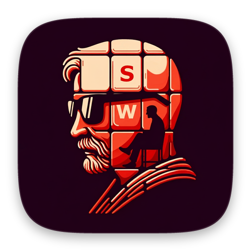

  

<h1 align="center">Subliminal Words</h1>

A picture puzzle game. Each picture hides a word. Find it and spell it. 
Featured in “New Games We Love” on the App Store, 2024.

  
  &nbsp;
  

Flutter · Firebase · RevenueCat · AdMob

## About the code

I built the first version in 2023 and 2024, starting from Flutter's casual games template. `lib/ui/letter_box.dart` and `lib/change_notifier/field_model.dart` are still mostly that code. Most changes since 2025 were made with AI coding agents.

Level pictures, music and sounds are not included.

## Known issues

- Decoy letters always come from the start of the alphabet, so answer letters late in the alphabet are easy to spot (`field_model.dart`).
- `lib/ui/screen/create_level_screen.dart` is 6,006 lines long.

© 2023–2026 Indest OÜ. All rights reserved.

Files with the Flutter project authors' header come from [Flutter's casual games template](https://github.com/flutter/games) and keep its BSD license ([third_party/flutter-games/LICENSE](third_party/flutter-games/LICENSE)). The fonts use the SIL Open Font License.
